# What's in ws

Every view of the web UI, with what it's for. ws is built to bring you in where your judgement is needed, so most of these are a way of putting something in front of you: a plan, a question, a diff, a document, a prototype, proof.

The pictures are of one workspace: Sorrel, a made-up company that sends invoices for small studios. [`just shots`](scripts/shots.mjs) takes them again. [The manual](MANUAL.md) says how each thing works.

- **Where work stands:** [Missions](#missions) · [A mission](#a-mission) · [The brief and the plan](#the-brief-and-the-plan) · [Work](#work) · [The orchestrator](#the-orchestrator)
- **Where you come in:** [Review](#review) · [Verify](#verify) · [Conversations](#conversations) · [Artifacts](#artifacts)
- **What's been written:** [Documents](#documents) · [A space](#a-space) · [A document](#a-document)
- **Your team's work:** [Reviews](#reviews) · [A pull request](#a-pull-request) · [Team](#team)
- **Getting around:** [Find](#find) · [Files](#files) · [Settings](#settings) · [Plugins](#plugins)

---

## Where work stands

### Missions

Every mission, grouped by whose court it's in. **Needs you** is everything waiting on you. **In progress** is an agent's, **Waiting** is outside (reviewers, CI, another team), and **Up next** is yours when you're ready.

<p align="center">
  <picture>
    <source media="(prefers-color-scheme: dark)" srcset="docs/assets/shots/missions-dark.webp">
    <source media="(prefers-color-scheme: light)" srcset="docs/assets/shots/missions-light.webp">
    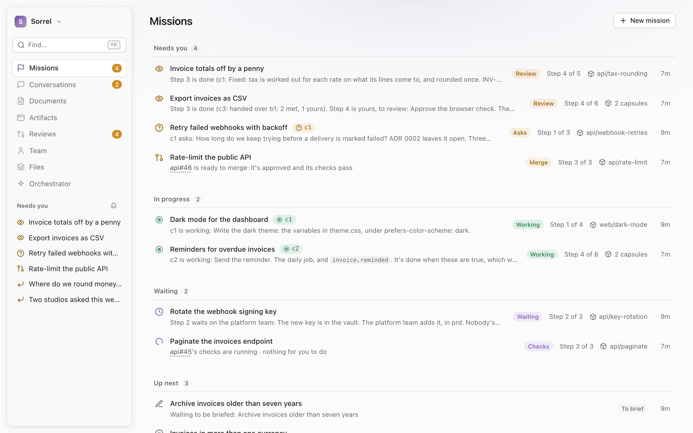
  </picture>
</p>

- Each row is the mission's headline: where it stands, and the one thing that moves it on.
- The sidebar keeps what needs you in view on every page, and the tab's icon lights when something lands there.
- Missions that have ended are behind *Show past* (`⇧A`).

### A mission

Where one mission stands, and what to do about it. The page leads with its headline and a button for the action that moves it on. Here that's a review, with the crew's handoff to read first.

<p align="center">
  <picture>
    <source media="(prefers-color-scheme: dark)" srcset="docs/assets/shots/mission-dark.webp">
    <source media="(prefers-color-scheme: light)" srcset="docs/assets/shots/mission-light.webp">
    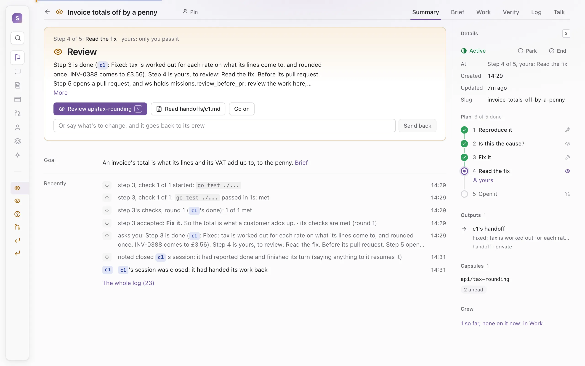
  </picture>
</p>

- **Plan** lists the steps, with the one it's at and which are yours.
- **Outputs** are what it has made: handoffs, documents, pull requests.
- **Crew** says who's on it, on which agent and model, and what each last said.
- *Recently* is the end of its log. The **Log** tab has all of it, and **Talk** is a conversation about this mission.

### The brief and the plan

What the mission is for, and the route there. The brief is yours: its goal, context and acceptance. The plan is its steps in order, each a kind ws knows (Work, Review, Verify, Decide, Open Pull Request, Land, Wait), with what has to be true for each to be done.

<p align="center">
  <picture>
    <source media="(prefers-color-scheme: dark)" srcset="docs/assets/shots/brief-dark.webp">
    <source media="(prefers-color-scheme: light)" srcset="docs/assets/shots/brief-light.webp">
    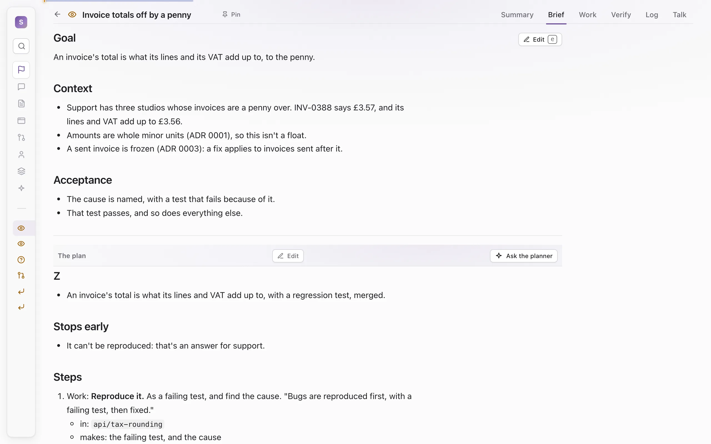
  </picture>
</p>

- A briefing agent proposes both, in a conversation, and nothing starts until you confirm them.
- A step the process asks for quotes its words, so you can see why it's there.
- *Edit* (`e`) changes either. *Ask the planner* has it revise the plan, and a revision that removes one of your steps comes to you first.

### Work

A mission's capsules, in the order they need you. A capsule is a git worktree off main, one in each repo the mission touches. The one that's open shows who worked there, the steps that ran there, its commits and its changed files.

<p align="center">
  <picture>
    <source media="(prefers-color-scheme: dark)" srcset="docs/assets/shots/work-dark.webp">
    <source media="(prefers-color-scheme: light)" srcset="docs/assets/shots/work-light.webp">
    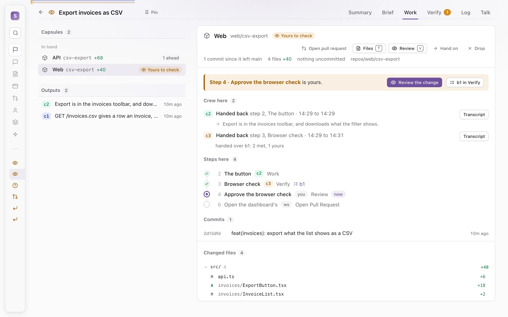
  </picture>
</p>

- From here: *Review* (`v`), *Files* (`f`), *Open pull request*, or hand the capsule on to a mission of its own.
- A capsule in a repo with no pull requests is landed from its review.

### The orchestrator

The agent that decides what happens between steps: when crew report done, when a pull request changes, when you answer. It reads the mission, then accepts a step, starts the next crew, or asks you.

<p align="center">
  <picture>
    <source media="(prefers-color-scheme: dark)" srcset="docs/assets/shots/orchestrator-dark.webp">
    <source media="(prefers-color-scheme: light)" srcset="docs/assets/shots/orchestrator-light.webp">
    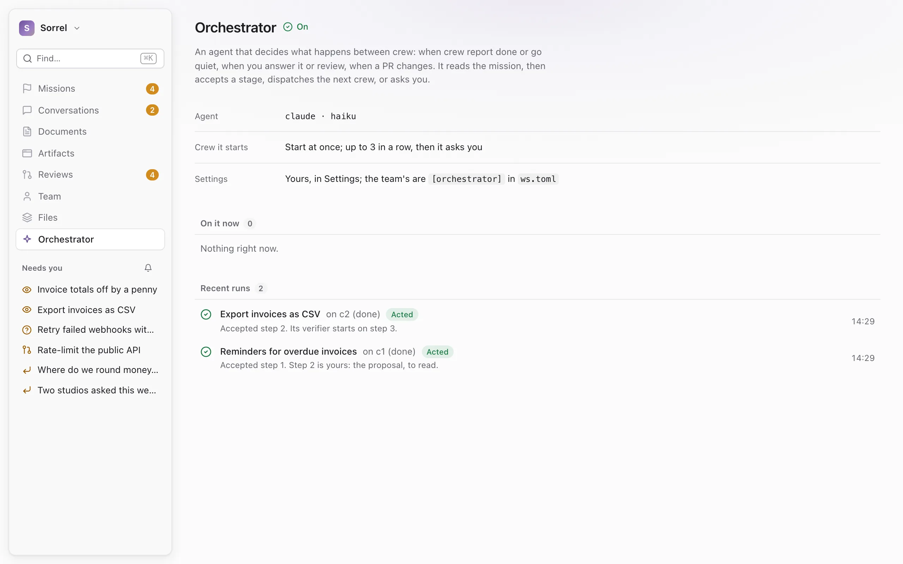
  </picture>
</p>

- Every run is kept: what it was told, what it said, and each command it ran.
- It acts only through `ws` commands, and ws refuses what isn't its to do, such as passing a step that's yours.
- It can be turned off, for you or for the team. Then nothing moves a mission on but you.

---

## Where you come in

### Review

A capsule's committed changes, file by file, keyboard first (`?` lists the keys). This is what a Review step asks of you, and what `review_before_pr` holds a pull request for.

<p align="center">
  <picture>
    <source media="(prefers-color-scheme: dark)" srcset="docs/assets/shots/review-dark.webp">
    <source media="(prefers-color-scheme: light)" srcset="docs/assets/shots/review-light.webp">
    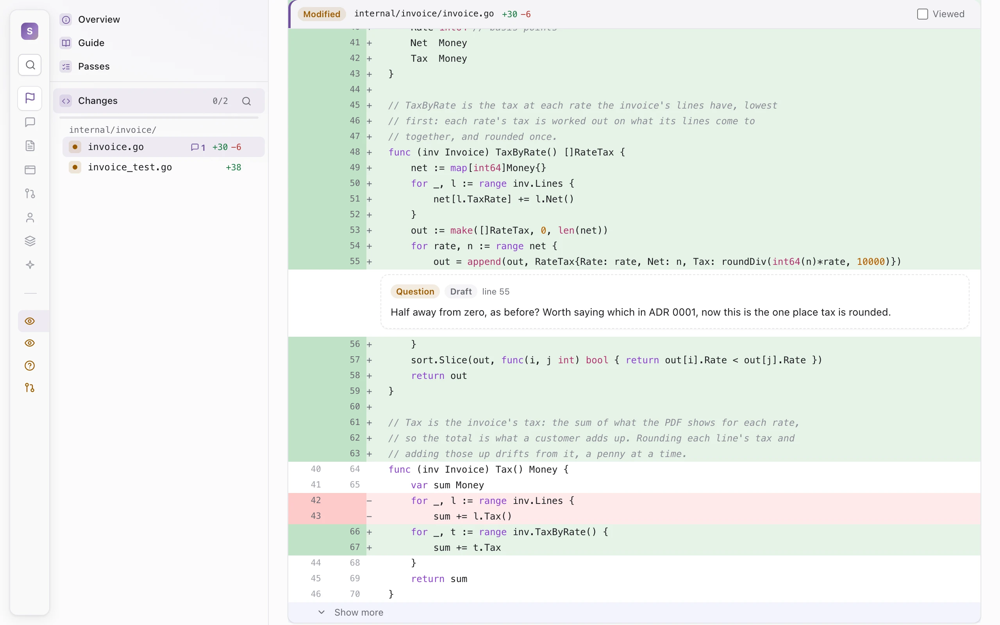
  </picture>
</p>

- A comment is on a line or a range, and has a kind: blocking, suggestion, question or nit. Crew answer each one.
- Your review is a draft until you submit it (`s`). Approving passes the step. Asking for changes sends it back to the crew who wrote it, and you re-review what they changed.
- *Guide* and *Passes* have an agent read the change first: a guide to it, and findings on its lines for you to take into your review or dismiss.

### Verify

Proof that the work does what it should, from someone who didn't do it. A Verify step has a fresh agent run the thing and hand over a bundle: each check with what it came to and what shows it.

<p align="center">
  <picture>
    <source media="(prefers-color-scheme: dark)" srcset="docs/assets/shots/verify-dark.webp">
    <source media="(prefers-color-scheme: light)" srcset="docs/assets/shots/verify-light.webp">
    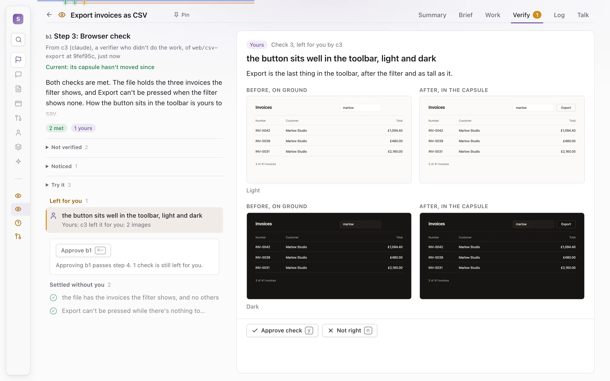
  </picture>
</p>

- *Left for you* is what the verifier couldn't settle, or was told is yours: a matter of taste, with what helps you judge it. *Settled without you* is a line each.
- What shows a check is a file: an image beside the same view before the change, a recording, or what a command printed.
- You approve a check (`y`) or say it isn't right (`n`). Sending a bundle back tells the crew who made the work what you said.

### Conversations

For thinking something through before, or beside, the work: `ws talk`. Its agent reads the repos, the missions and GitHub, and changes nothing of the workspace's.

<p align="center">
  <picture>
    <source media="(prefers-color-scheme: dark)" srcset="docs/assets/shots/conversation-dark.webp">
    <source media="(prefers-color-scheme: light)" srcset="docs/assets/shots/conversation-light.webp">
    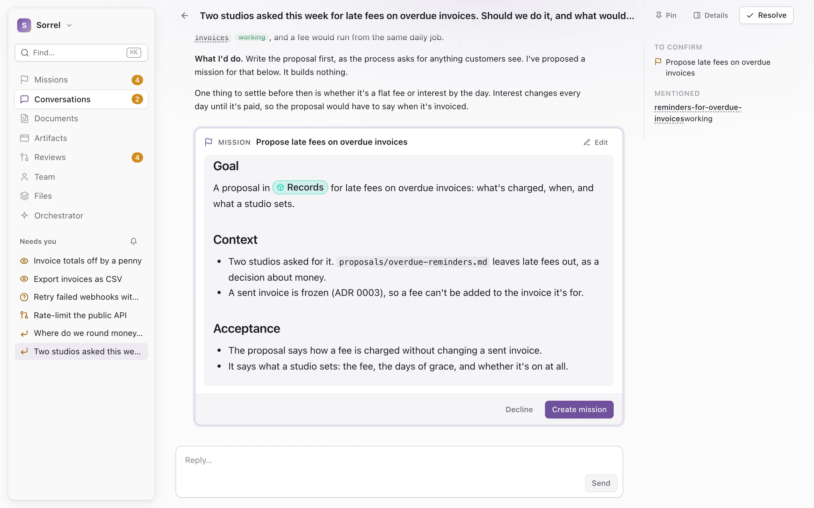
  </picture>
</p>

- What's worth keeping, it proposes, and you confirm: a mission, a decision, a document, an artifact.
- Names in what's said are links: a mission, a file and its lines, a pull request.
- A mission's **Talk** tab is the same, about that mission: there it can propose a change to the brief, crew to start, or a new plan.

### Artifacts

Something to look at and use, for when that's better than a description: a mock-up, two takes on a layout, a diagram to click through. An artifact is one HTML file, kept in versions.

<p align="center">
  <picture>
    <source media="(prefers-color-scheme: dark)" srcset="docs/assets/shots/artifact-dark.webp">
    <source media="(prefers-color-scheme: light)" srcset="docs/assets/shots/artifact-light.webp">
    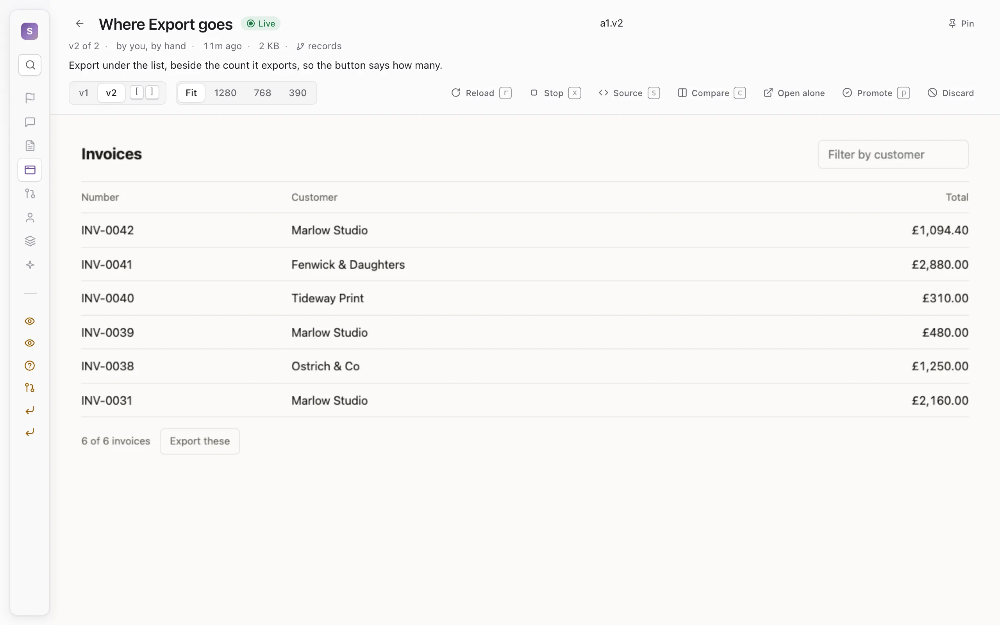
  </picture>
</p>

- Each version says who made it, what it's based on and what changed. *Compare* (`c`) puts two side by side.
- It runs in a frame that fetches nothing and keeps nothing, at the width you pick.
- They're sketches, and expire. *Promote* (`p`) keeps one.

---

## What's been written

### Documents

A repo of ADRs, proposals and notes is a **space**: ws reads it, lists it by kind, and searches it. *Documents* (`g d`) starts with what changed lately and what's in flight, across every space.

<p align="center">
  <picture>
    <source media="(prefers-color-scheme: dark)" srcset="docs/assets/shots/documents-dark.webp">
    <source media="(prefers-color-scheme: light)" srcset="docs/assets/shots/documents-light.webp">
    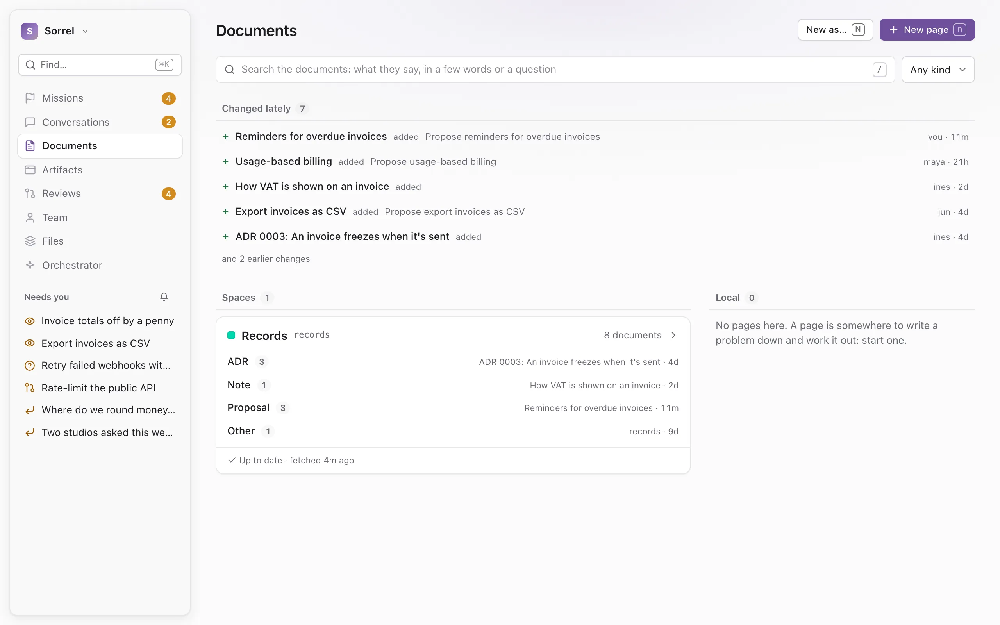
  </picture>
</p>

- The box at the top searches by what documents say, in a few words or a question.
- A workspace says what kinds of document it has, where each goes, and how one's written. Agents follow that when they write one.
- *Local* is your own pages: somewhere to work a problem out, with an agent asked in where you want one.

### A space

One space's documents by kind, with the one you've picked beside the list. `j` and `k` move through it, and `⏎` opens the reader.

<p align="center">
  <picture>
    <source media="(prefers-color-scheme: dark)" srcset="docs/assets/shots/space-dark.webp">
    <source media="(prefers-color-scheme: light)" srcset="docs/assets/shots/space-light.webp">
    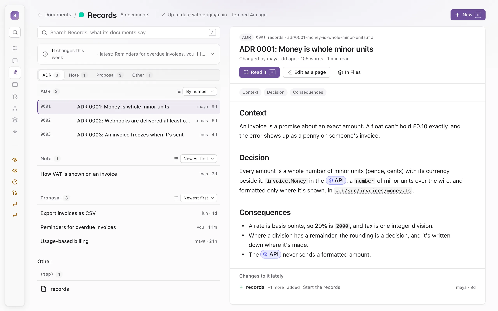
  </picture>
</p>

- Its heading says how it stands with its remote, and what's changed this week.
- A document being changed in a capsule says so, and opens as it reads there.

### A document

A document as it reads on its default branch, with its sections beside it.

<p align="center">
  <picture>
    <source media="(prefers-color-scheme: dark)" srcset="docs/assets/shots/document-dark.webp">
    <source media="(prefers-color-scheme: light)" srcset="docs/assets/shots/document-light.webp">
    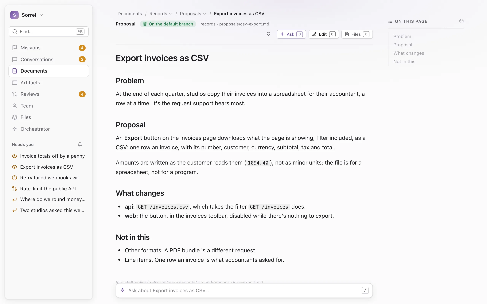
  </picture>
</p>

- *Ask* (`a`) asks an agent about it. *Edit* (`e`) edits it as a page.
- A document a mission made is commented on where you read it: select some text and press `c`, for a question, a change you want, or a note. Threads sit in the margin, as in a shared doc.
- Below it is what cites it, and what it cites.

---

## Your team's work

### Reviews

The open pull requests across your repos (`g r`). Your teammates' come first: those that need your review, then those back with you after you asked for changes. Yours are below, by whether they're ready to merge.

<p align="center">
  <picture>
    <source media="(prefers-color-scheme: dark)" srcset="docs/assets/shots/reviews-dark.webp">
    <source media="(prefers-color-scheme: light)" srcset="docs/assets/shots/reviews-light.webp">
    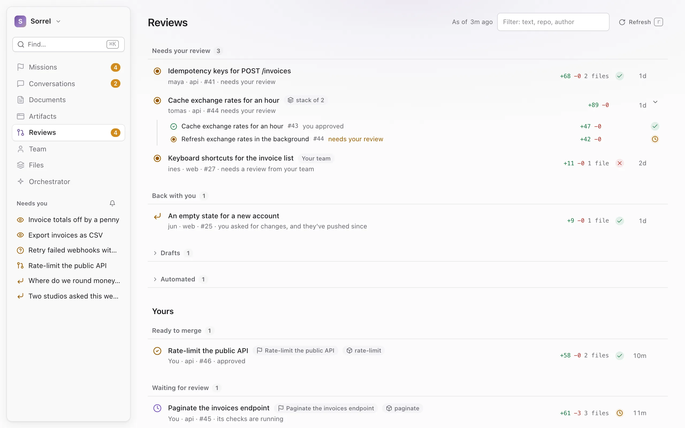
  </picture>
</p>

- A stack is listed as one, with each pull request's standing under it.
- Drafts and bots' are folded away.
- One of yours that belongs to a mission says which.

### A pull request

A teammate's pull request, on the page a capsule's review is: the same keys, the same kinds of comment, and a draft until you submit.

<p align="center">
  <picture>
    <source media="(prefers-color-scheme: dark)" srcset="docs/assets/shots/pull-request-dark.webp">
    <source media="(prefers-color-scheme: light)" srcset="docs/assets/shots/pull-request-light.webp">
    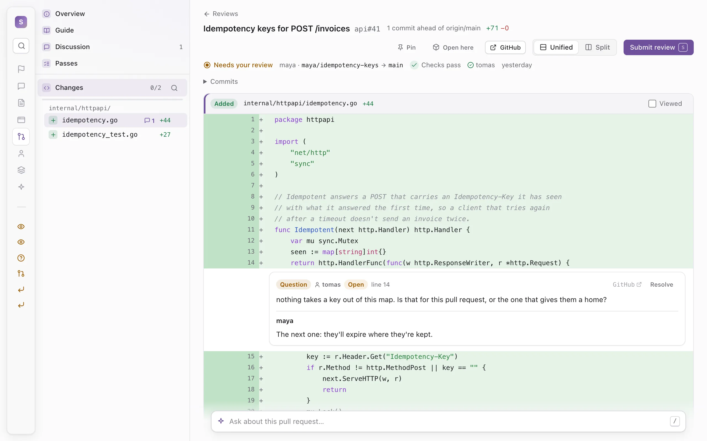
  </picture>
</p>

- Threads from GitHub are on their lines, and you answer or resolve them here.
- Submitting posts your review on GitHub, as you.
- The box at the foot asks an agent about the change.

### Team

What the people in your repos have been doing, by day (`g t`). It's about the work, so you know who to ask: there are no counts, and nothing is said of anyone who did nothing.

<p align="center">
  <picture>
    <source media="(prefers-color-scheme: dark)" srcset="docs/assets/shots/team-dark.webp">
    <source media="(prefers-color-scheme: light)" srcset="docs/assets/shots/team-light.webp">
    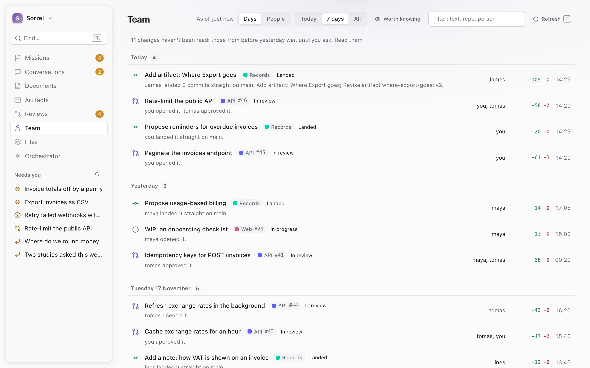
  </picture>
</p>

- A line a change: what it is, where it stands, and who was on it.
- By day or by person, for today, a week, or all of it.

---

## Getting around

### Find

`⌘K`, from anywhere. It finds a thing by what you remember of it: a capsule, a document, a decision, what someone said in a review, a file.

<p align="center">
  <picture>
    <source media="(prefers-color-scheme: dark)" srcset="docs/assets/shots/find-dark.webp">
    <source media="(prefers-color-scheme: light)" srcset="docs/assets/shots/find-light.webp">
    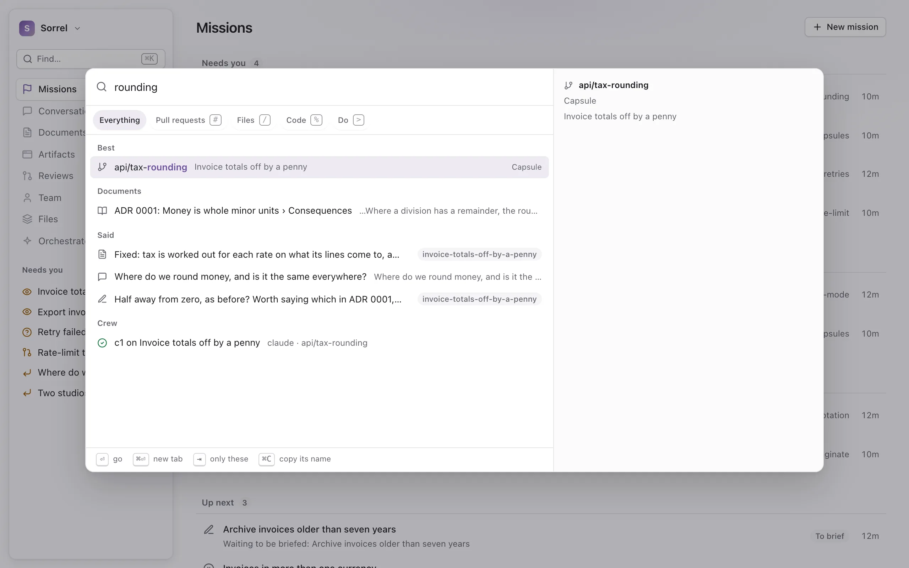
  </picture>
</p>

- A name or an address goes straight there: `api/internal/invoice/invoice.go:20`, `api#41`, a link copied from GitHub.
- It can be kept to pull requests (`#`), files (`/`) or code (`%`), and `>` lists what there is to do.
- `ws find` is the same from a shell, and agents use it too.

### Files

Every repo's files, on its default branch or in any capsule.

<p align="center">
  <picture>
    <source media="(prefers-color-scheme: dark)" srcset="docs/assets/shots/files-dark.webp">
    <source media="(prefers-color-scheme: light)" srcset="docs/assets/shots/files-light.webp">
    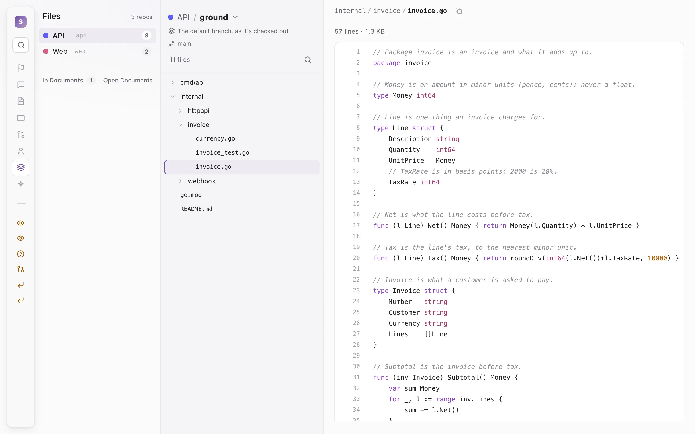
  </picture>
</p>

- `t` finds a file by name.
- A repo that's a space is under *In Documents*: its files are read as documents.

### Settings

What's yours in this workspace, kept in `ws.local.toml` beside the team's `ws.toml`, in sections: how the web UI looks, which agent and model each role runs on, how a mission goes and the guarantees ws holds.

<p align="center">
  <picture>
    <source media="(prefers-color-scheme: dark)" srcset="docs/assets/shots/settings-dark.webp">
    <source media="(prefers-color-scheme: light)" srcset="docs/assets/shots/settings-light.webp">
    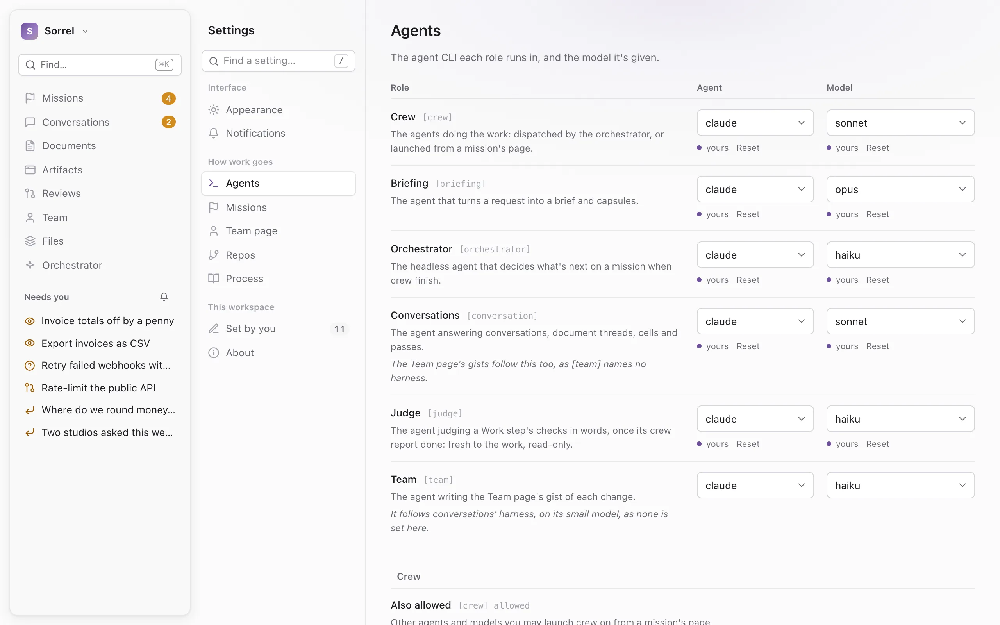
  </picture>
</p>

- A role is who does a kind of work: crew, briefing, the orchestrator, conversations, the judge.
- Each setting says whether it's yours or the team's, and *Reset* goes back to the team's.
- *Set by you* lists everything your file sets, and *Find a setting…* (`/`) reads every section.
- The team's process is a section of its own, as the planner and the orchestrator read it.

### Plugins

A plugin is a program that adds to the workspace: a view in the sidebar, commands after `ws`, and names ws recognises wherever they're written, such as a tracker's `RAM-123`. Its things are found by Find, and a mission can be about one.

```sh
ws plugin add withworkspace/plugin-plugin-dev
```

They're written with [the plugin framework](https://github.com/withworkspace/plugin). [The manual](MANUAL.md#plugins) says what one can do.
