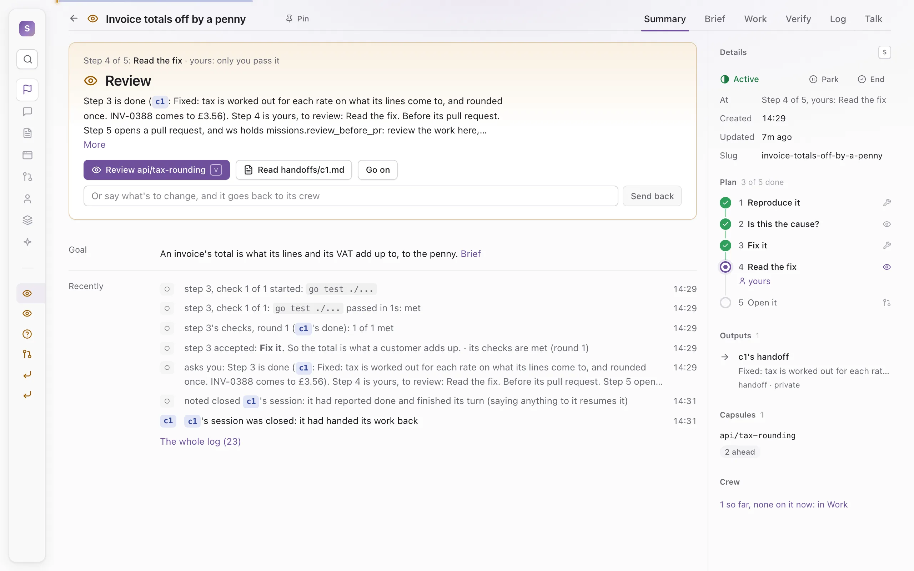
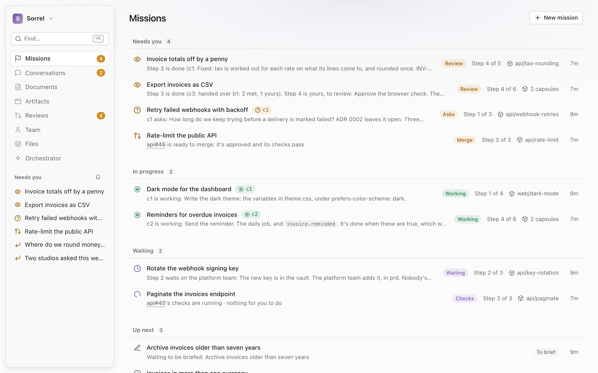
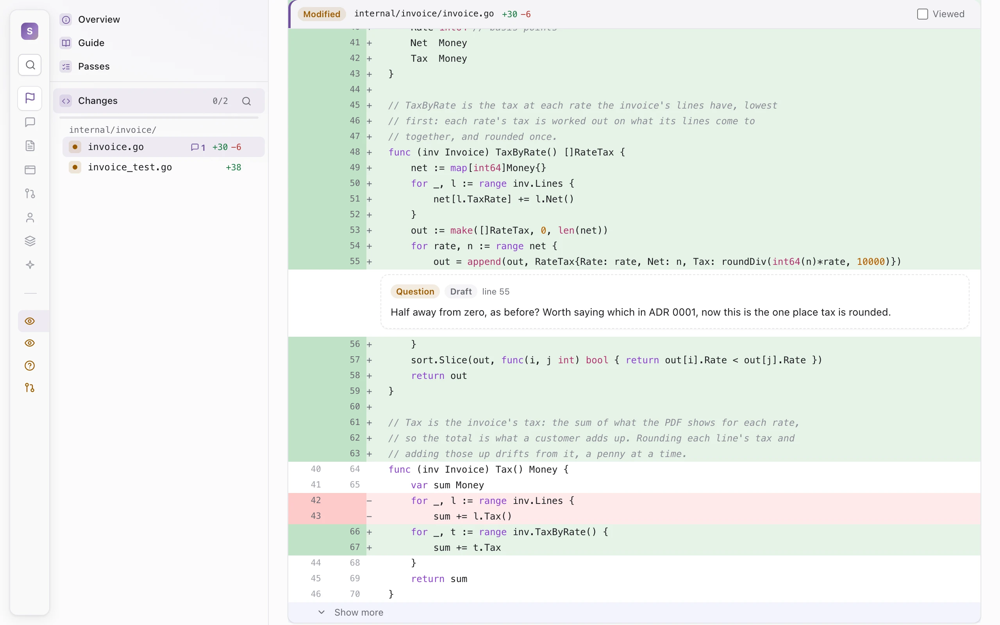
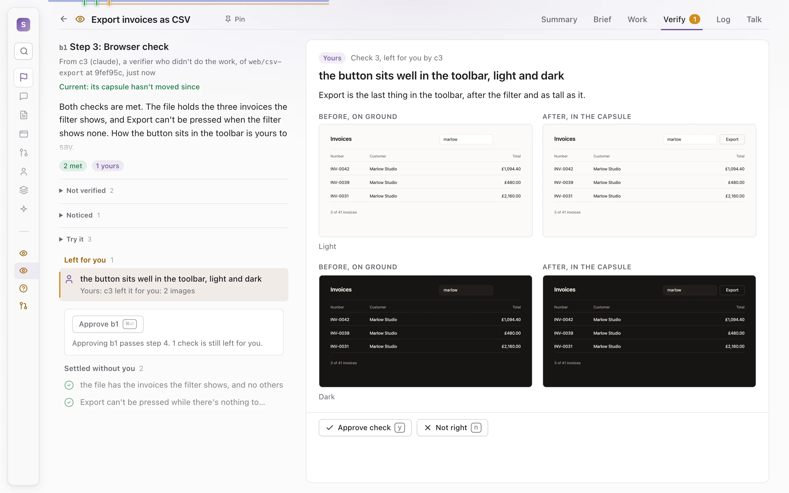

<p align="center">
  <picture>
    <source media="(prefers-color-scheme: dark)" srcset="docs/assets/wordmark-dark.png">
    <source media="(prefers-color-scheme: light)" srcset="docs/assets/wordmark-light.png">
    
  </picture>
</p>

<p align="center">
  Bring agents into your process.
</p>

---

**workspace** (`ws`) is where you and agents work together, to a process you wrote. Agents plan the work, do it and check it. ws brings you in where your judgement is needed, and not before: to confirm a plan, to answer a question, to read a proposal, to review a change, to say whether it looks right.

It isn't trying to take you out of the work. It's trying to spend your attention well. Each time it comes to you, what you need to decide is ready: the diff, the document, a prototype to click through, proof that it works.

It runs on your machine: a daemon that keeps agents working after you close the tab, a web UI that shows what needs you, and a CLI that you and the agents both use.

<p align="center">
  <picture>
    <source media="(prefers-color-scheme: dark)" srcset="docs/assets/shots/mission-dark.webp">
    <source media="(prefers-color-scheme: light)" srcset="docs/assets/shots/mission-light.webp">
    
  </picture>
</p>

A bug, at the fourth of its five steps. Crew reproduced it as a failing test, you agreed that was the cause, crew fixed it, and ws ran the plan's checks. Now it's yours to review, and no pull request opens until you have.

## Where you come in

Most of a piece of work happens without you. These are the moments that don't, and what ws puts in front of you at each.

- **A plan to confirm.** An agent reads the code, asks you what's unclear, and proposes a brief and the steps to get there, saying which are yours. Nothing starts until you confirm it.
- **A question to answer.** When an agent can't decide something, it asks, with the answers it would act on. Yours is kept as a decision.
- **A document to read.** A proposal or an ADR is commented on in its margin, as a shared doc is, before anything is built from it.
- **A prototype to try.** An artifact is a page you can click through, kept in versions you can put side by side.
- **A change to review.** The diff, file by file, with your comments on its lines.
- **Proof to check.** An agent who didn't build the thing runs it, and hands over what it saw and what's left for your eye.
- **A pull request to merge.**

<p align="center">
  <picture>
    <source media="(prefers-color-scheme: dark)" srcset="docs/assets/shots/missions-dark.webp">
    <source media="(prefers-color-scheme: light)" srcset="docs/assets/shots/missions-light.webp">
    
  </picture>
</p>

Every piece of work is in one court: yours, an agent's, or outside (reviewers, CI, another team). The list is grouped that way, so **Needs you** is everything waiting on you, each with the one thing that moves it on. The tab's icon lights when something lands there.

## How a mission goes

A **mission** is a unit of work: a brief, a plan, the worktrees it's done in, and a record of what happened.

1. **Ask.** `ws mission new "Invoice totals are off by a penny"`, or say it in a conversation, or paste an issue's address.
2. **Brief and plan.** A briefing agent proposes a brief and a plan: the steps in order, what has to be true for each to be done, and the steps that are yours. You confirm it.
3. **Work.** **Crew** are agents in your own CLI (Claude Code, Cursor, pi, Codex, OpenCode), on your own account. Each works a step in a **capsule**, a git worktree off main, one in each repo the mission touches. They hand over to each other in writing, so the next agent starts from what the last one learned.
4. **Check.** When crew say they're done, ws checks. A check that's a command (`go test ./...` passes) ws runs itself. One in words goes to a judge, an agent that didn't do the work.
5. **Review.** A step that's yours is a checkpoint, and nothing else passes it. You approve the work, or send it back to the crew who made it.
6. **Land.** ws opens the pull request and looks after it while it's open: failing checks go back to crew. When it merges, the mission ends, and what it decided and made stays findable.

Between steps, an orchestrator (a headless agent) reads what happened and decides what's next. It acts only through `ws` commands, so what it may do is what ws lets it.

## Your process, and what ws holds

When you're brought in is yours to say. How work goes is written in prose, in a `PROCESS.md` beside your config:

```markdown
Bugs are reproduced first, with a failing test, then fixed. I see the
cause before the fix is written.

A change to the dashboard is shown working in a browser, by someone who
didn't build it.

I review every change before its pull request is opened, and only I
merge.
```

The planner writes each mission's plan from it, and the orchestrator reads it to decide what happens next. A step the process asks for quotes its words.

What shouldn't depend on an agent reading that right is a **guarantee**. ws holds these itself, and refuses whoever asks:

```toml
[missions]
review_before_pr = true   # no pull request until your review approves the capsule as it is
max_rounds = 2            # a step's checks unmet twice, and it's yours
```

## Review, and proof

<p align="center">
  <picture>
    <source media="(prefers-color-scheme: dark)" srcset="docs/assets/shots/review-dark.webp">
    <source media="(prefers-color-scheme: light)" srcset="docs/assets/shots/review-light.webp">
    
  </picture>
</p>

A capsule's review is its committed changes, file by file, keyboard first. Comments have kinds (blocking, suggestion, question, nit), so crew know what to do with each. Your teammates' pull requests are reviewed on the same page, with the same keys.

<p align="center">
  <picture>
    <source media="(prefers-color-scheme: dark)" srcset="docs/assets/shots/verify-dark.webp">
    <source media="(prefers-color-scheme: light)" srcset="docs/assets/shots/verify-light.webp">
    
  </picture>
</p>

A diff doesn't show that a button works. A **Verify** step has an agent who didn't build the thing run it, and hand over a bundle: each check with what it came to and what shows it, what it couldn't verify, and what's left for you to judge.

## What else is in it

- **Conversations** (`ws talk`). Think something through with an agent that reads the repos, the missions and GitHub. What's worth keeping it proposes, and you confirm: a mission, a decision, a document.
- **Documents.** A repo of ADRs and proposals is a space ws reads, lists by kind and searches. Agents write into it through the same review as code.
- **Find** (`⌘K`, `ws find`). Anything by what it says: a decision, a brief, a review comment, a document, a file.
- **Team.** What the people in your repos have been doing, by day.
- **Plugins.** Programs that add a view, commands and names ws recognises wherever they're written, such as a tracker's `RAM-123`. They're written with [the plugin framework](https://github.com/withworkspace/plugin).

[FEATURES.md](FEATURES.md) shows every view, and the [manual](MANUAL.md) says how each works.

## Capsules

Under the missions is a way of keeping repos that works with no agent at all. Each repo is a bare clone with a worktree for every piece of work, so nothing is stashed and nothing is switched. [METHOD.md](METHOD.md) says why.

```sh
ws lift api tax-rounding      # a new capsule: a branch and a worktree, off main
ws dock web 27                # someone's pull request, checked out beside your work
ws jump api                   # go to a capsule, by a few letters of its name
ws rg formatMoney             # ripgrep across repos, one worktree each
ws debrief                    # remove what's landed
```

`ws` alone opens the web UI, `ws status` shows every repo and capsule, and `ws --help` lists the rest.

## Get started

**Install** a release, for macOS on Apple silicon and Linux (amd64, arm64):

```sh
curl -fsSL https://raw.githubusercontent.com/withworkspace/workspace/main/scripts/install.sh | bash
```

That puts the latest release at `~/.local/bin/workspace`, checked against the release's checksums. `ws upgrade` installs the next one in its place. Then, in your `~/.zshrc`:

```sh
eval "$(workspace shell-init zsh)"
```

This gives you `ws`, with completions and `cd` into capsules.

**You'll need** Git, the [GitHub CLI](https://cli.github.com/) signed in, and an agent's CLI for crew: [Claude Code](https://www.anthropic.com/claude-code), Cursor's, pi, Codex or OpenCode. `[crew]` in your config says which.

**Make a workspace.** A workspace is a config repo, which says what your repos are, and the clones beside it. If your team has one:

```sh
ws init git@github.com:your-org/workspace-config.git
```

Otherwise, start one. It's a repo with a `ws.toml` in it:

```toml
[workspace]
org = "your-org"            # where your repos are on GitHub
default_branch = "main"

[repos.api]
display_name = "API"

[repos.web]
display_name = "Web"
aliases = ["fe"]

[crew]
harness = "claude"
```

```sh
git init sorrel-config && cd sorrel-config    # with the ws.toml above
git add ws.toml && git commit -m "Our workspace"
ws init . ~/sorrel
```

**Open it:**

```sh
cd ~/sorrel
ws web
```

Say what you want in a conversation there, and its agent proposes a mission.

To build ws from a clone instead: `just build` (Go, Node, [pnpm](https://pnpm.io) and [just](https://github.com/casey/just)), which leaves `bin/workspace`.

## What it runs, and where

- **On your machine.** The daemon is one process for each workspace. Its web UI listens on `127.0.0.1`, and the link `ws web` opens signs your browser in.
- **As you.** Agents are your own CLIs, on your own accounts: ws has no model and no account of its own. GitHub is reached through `gh`.
- **In your workspace's folder.** What ws records (missions, reviews, conversations) is in `.ws/`, a SQLite file it backs up daily.
- **A plugin is a program that runs as you.** Install one as you would any other.

## Status

ws is at 0.x. It's used every day to build itself, and it changes quickly: expect things to move between releases.

## License

MIT
